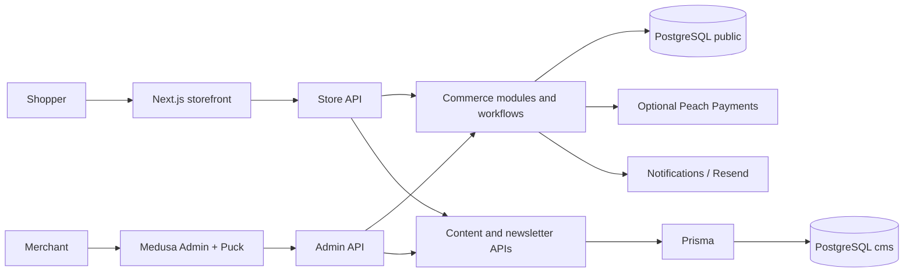

# Architecture

## Runtime boundaries

The Next.js storefront runs on port 8000. Medusa exposes Store APIs, Admin APIs and the merchant Admin on port 9000. Storefront data functions under `apps/storefront/src/lib/data` use Medusa's JavaScript SDK. Customer authentication and cart identity use storefront cookies. Backend secrets stay on the backend.

## Persistence ownership

| Owner  | Data                                                                                      | Migration system                      |
| ------ | ----------------------------------------------------------------------------------------- | ------------------------------------- |
| Medusa | Products, variants, prices, inventory, customers, carts, orders, payments and fulfillment | `public` schema; `medusa db:migrate`  |
| Prisma | Content, revisions and subscribers                                                        | `cms` schema; `prisma migrate deploy` |

`DATABASE_URL` connects Medusa; `CMS_DATABASE_URL` selects the CMS schema. They can use the same database with separate schema ownership. Never introspect Medusa tables into Prisma or use Prisma for commerce mutations. New commerce extensions use Medusa modules, links and workflows, with generated migrations.

## Catalog and regions

Medusa owns options, variant combinations, prices, inventory and image associations. `product-detail.tsx` synchronizes the selected variant, URL, gallery and purchase actions. Variants without image associations fall back to product images. Preserve variant IDs and inventory behavior when changing UI.

`src/migration-scripts/south-africa.ts` seeds ZAR, a South Africa region, manual payment and a sample shipping option. Additional currencies need explicit prices and regions; no exchange-rate service is connected. Shipping is an illustrative manual option, not a courier integration. `seed-content.ts` and `expand-store.ts` supply demo content/catalog data.

## Cart and checkout

1. `lib/data/cart.ts` retrieves/creates carts and coordinates cookie identity.
2. Medusa supplies authoritative quantities, promotions, shipping, taxes and totals. Basket components display those values.
3. Checkout unlocks address, delivery, payment and review based on cart state. Empty carts redirect to the basket.
4. Manual payment completes local demo orders. Optional Peach creates a hosted session and redirects the shopper.
5. `app/api/peach-return/route.ts` uses the existing cart cookie and invokes order completion. Browser return parameters do not establish payment success; Medusa/provider authorization determines the outcome.

See [Peach configuration](SETUP.md#peach-payments). Manual checkout tests do not verify Peach settlement.

## Content lifecycle

`Content` contains kind (`page` or `post`), slug, metadata, legacy blocks, visual layout, publication snapshot and integer version. `(kind, slug)` is unique. `ContentRevision` stores prior saved versions.

`src/lib/cms.ts` validates structure, component types, IDs, links, image sources and rich text. `src/lib/content-write.ts` checks stale versions and writes revisions/content transactionally. Saving a draft preserves the previous live snapshot. Publishing replaces the snapshot; unpublishing excludes the entry from public results. Restoring a revision creates draft content that needs publication.

The `home` page controls the homepage. Selected policy slugs override their routes. Other pages use `/[country]/pages/[slug]`; journal posts use `/[country]/blog/[slug]`. Published content can remain cached for 60 seconds. The public API takes the newest 100 entries before filtering kind/slug; admin lists up to 200. Add database filtering and pagination before larger deployments.

Admin and storefront share `packages/page-builder`. Its component factory receives the host's React `createElement` to avoid mixing Admin React 18 and storefront React 19. New blocks need matching shared configuration, server validation and rendering support. Header, footer and commerce templates are code-controlled.

## Notifications and newsletter

`src/modules/email` implements notifications; `src/subscribers/commerce-emails.ts` selects events. Log mode sends no messages. Resend requires credentials and a verified sender. The shipping template is not connected to shipment events.

Newsletter endpoints validate consent, request token-based confirmation and support unsubscribe. Admin exports confirmed subscribers. Rate limiting is process-local; export considers the newest 500 signups. Production requires a shared limiter, pagination/retention decisions and synchronization with any marketing service. Keep tokens private.

## Infrastructure

Docker Compose supplies PostgreSQL and Redis locally. Redis availability does not automatically enable Medusa Redis event, workflow or locking providers. Local defaults are in-memory. Multiple processes require explicit durable infrastructure, shared uploads, backups and observability. Local setup seeds demo data and creates credentials; it is not a production release command.
